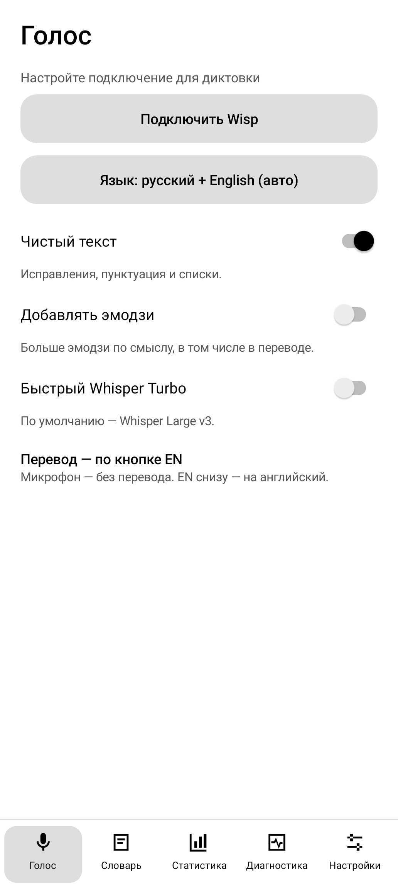
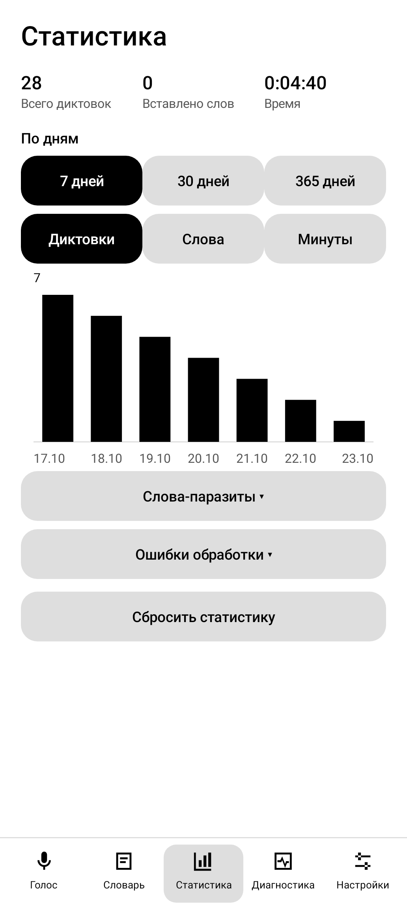
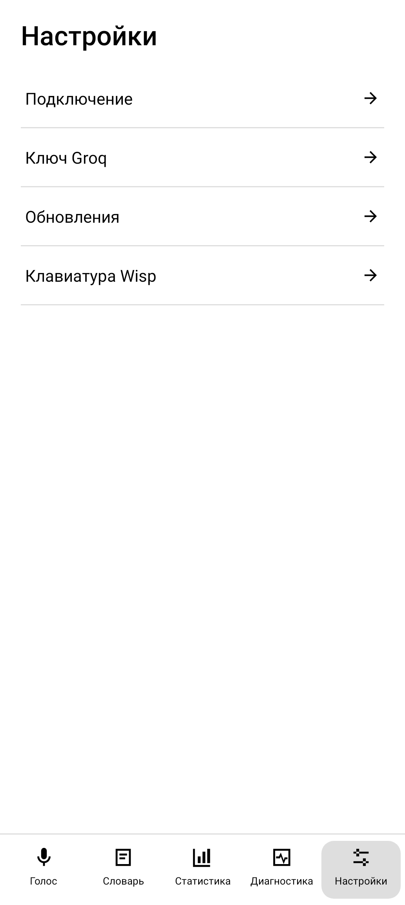
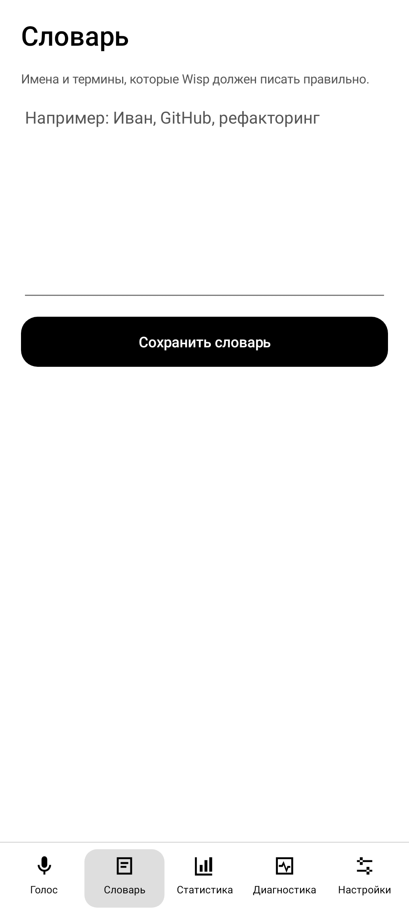
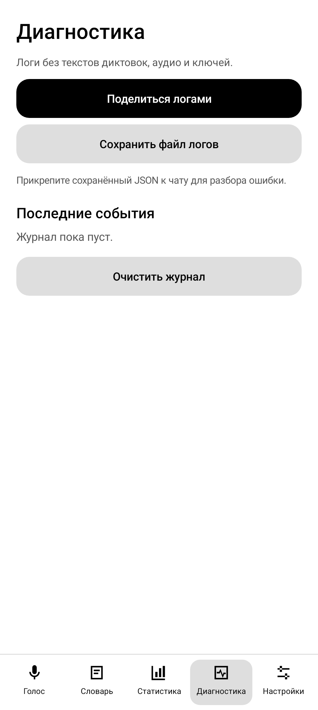
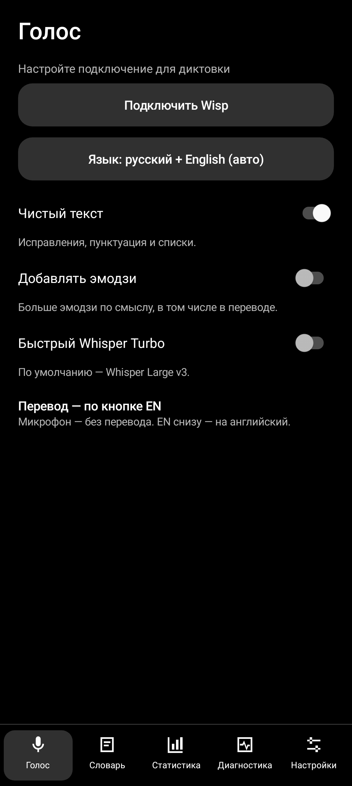

# Wisp: спокойный интерфейс для ежедневной диктовки

Ориентир — системные настройки Pixel: короткие строки, понятные иконки, детали по нажатию. Постоянная нижняя навигация следует привычной схеме Android. Светлая и тёмная темы остаются чёрно-белыми.

| Голос | Статистика | Настройки |
| --- | --- | --- |
|  |  |  |
| Повседневные переключатели без длинной ленты. | Сразу цифры и график; подробности раскрываются. | Четыре строки вместо больших блоков. |

| Словарь | Диагностика | Тёмная тема |
| --- | --- | --- |
|  |  |  |
| Отдельное поле для имён и терминов. | Сразу события и отправка логов. | Та же структура, системная тема. |

Снимки получены отрисовкой настоящих Android-экранов в облачных проверках на размере Pixel. Это не фотографии телефона; статистика на примере — тестовая. На уже подключённом телефоне кнопка первичной настройки на странице «Голос» скрывается.

Подключение, Groq-ключ, обновления и запасная клавиатура открываются из «Настроек». Большие приветственные блоки, пробное поле диктовки и нижние рекомендации убраны. Нижние вкладки всегда остаются на месте, содержимое прокручивается отдельно.

Для дальнейшего обсуждения: индивидуальное положение микрофона в каждом приложении. Эта идея пока не реализована; сначала стоит оценить новую навигацию в ежедневном использовании.
